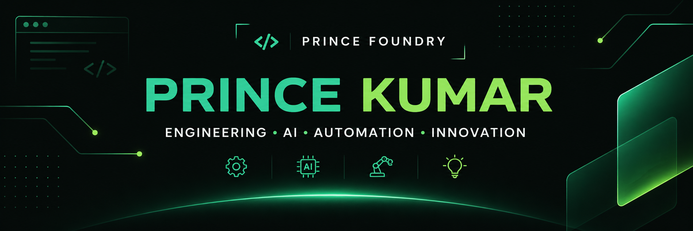

<!-- =========================================================
     PRINCE KUMAR | PRINCE FOUNDRY
     Senior Software Engineer | Founder @ AEVRIX
     ========================================================= -->

<!-- HERO SECTION -->

  

    

  

  <h3>Senior Software Engineer · Founder · AI & Automation Builder</h3>

  

    
    
  

  <h4>BUILD. &nbsp; EXPERIMENT. &nbsp; INNOVATE.</h4>

  

    
    
  

---

<!-- ABOUT ME -->

## 👨‍💻 About Me

I'm **Prince Kumar**, a Senior Software Engineer, technology enthusiast, and entrepreneur passionate about building software, exploring emerging technologies, and turning ideas into practical solutions.

My professional journey spans software engineering, quality engineering, test automation, full-stack development, and AI-powered applications.

I'm particularly interested in the intersection of **Artificial Intelligence, Agentic Systems, Automation, and Product Engineering**.

I enjoy building systems that don't just process information but can understand context, interact with applications, make decisions, and execute meaningful tasks.

I'm also the Founder of **[AEVRIX](https://aevrix.in/)**, a technology and creative solutions company working across AI automation, custom AI agents, AI-powered products, web development, cinematic creative production, and digital growth.

### ⚡ What I'm Focused On

- 🤖 Building AI agents and multi-agent systems using LangChain and LangGraph.
- 🧠 Exploring LLMs, Agentic AI, multimodal models, and intelligent workflows.
- 🎮 Developing AI-powered gaming and desktop automation frameworks.
- 🌐 Building full-stack applications and immersive web experiences.
- 👁️ Exploring computer vision, OCR, VLMs, and intelligent UI understanding.
- 🚀 Building AI-powered SaaS products and practical automation solutions.
- 🧪 Engineering reliable software through automation and quality engineering.
- ⚙️ Experimenting with AI coding agents, developer tools, and autonomous workflows.

---

<!-- CURRENT WORK -->

## 🔭 What I'm Building & Exploring

<table>
<tr>
<td width="50%" valign="top">

### 🤖 AI & Agentic Systems

- Multi-agent architectures
- LangGraph-based workflows
- LLM-powered task execution
- Intelligent browser automation
- AI-powered communication workflows
- Context-aware task automation
- Autonomous AI assistants

</td>
<td width="50%" valign="top">

### 🎮 AI Gaming Automation

- Android gaming agents
- PC game automation
- Vision-based interaction
- OCR and screen understanding
- Game-specific agent skills
- Automated gameplay testing
- Multi-device automation

</td>
</tr>
<tr>
<td width="50%" valign="top">

### 🌐 Software & Product Engineering

- MERN stack applications
- Next.js applications
- REST API development
- Backend architecture
- Interactive 3D websites
- AI-powered SaaS concepts
- Scalable web applications

</td>
<td width="50%" valign="top">

### 🎨 Creative Technology – AEVRIX

- AI-powered advertisements
- Cinematic product creatives
- UGC-style video production
- Custom AI chatbots and agents
- Digital experiences
- Brand and performance marketing
- Creative automation

</td>
</tr>
</table>

---

<!-- TECHNOLOGY STACK -->

## 🛠️ Technologies & Tools

### Programming Languages

  

### Frontend & Backend Development

  

### AI, Automation & Intelligent Systems

  

  
  
  
  
  
  
  

### Test Automation & Quality Engineering

  

  
  
  
  
  

### Development Tools & Platforms

  

---

<!-- ENGINEERING INTERESTS -->

## 🧠 Areas of Interest

  
  
  
  
  
  

---

<!-- FEATURED PROJECT AREAS -->

## 🚀 Featured Areas of Engineering

I enjoy working on projects that combine software engineering, AI, automation, and practical problem-solving.

| Project Area | Description | Technologies |
|:---|:---|:---|
| AI Gaming Agent | Intelligent gameplay automation and decision-making | Python, Appium, LangGraph, OCR |
| Multiplayer Game Automation | Multi-device game testing and automated interactions | Python, Appium, Android |
| PC Gaming Agent | AI-driven desktop and game UI automation | Python, OpenCV, OCR, VLM |
| AI Browser Automation | Intelligent browser interaction and task execution | AI Agents, LLMs, Browser Automation |
| Full-Stack Applications | Modern web applications and backend systems | React, Next.js, Node.js, MongoDB |
| AI Workflow Automation | Context-aware agents and automated workflows | LangChain, LangGraph, Azure AI |
| Creative AI Applications | AI-assisted content and advertising production | Generative AI, Creative Tools |

  

---

<!-- COMPANY -->

## 🏢 Building AEVRIX

  <h1>AEVRIX</h1>

  <h3>Automate Smarter. Scale Faster.</h3>

  

    <b>Technology · Artificial Intelligence · Creative Innovation</b>
  

  

I'm the Founder of **AEVRIX**, a technology and creative solutions company focused on helping businesses build, automate, and grow through technology.

At AEVRIX, we're bringing together software engineering, AI, automation, and creative production.

### What We're Working On

- 🤖 Custom AI agents, intelligent chatbots, and business automation.
- 🧠 AI-powered SaaS products and intelligent digital platforms.
- 🎬 Cinematic AI advertisements, UGC-style creatives, and product storytelling.
- 🌐 Modern websites, full-stack applications, and immersive 3D experiences.
- 📈 SEO, social media strategy, and performance marketing.
- ⚡ Technology-driven solutions that help businesses work smarter.

**Website:** https://aevrix.in/

---

<!-- GITHUB STATISTICS -->

## 📊 GitHub Statistics

  

  

    

  

---

<!-- CONTRIBUTION GRAPH -->

## 📈 Contribution Activity

  

---

<!-- CONNECT WITH ME -->

## 🌐 Let's Connect

I'm always interested in connecting with software engineers, developers, founders, AI enthusiasts, and people building interesting things.

  

  

  

  

  

---

<!-- FOOTER -->

  <h3>💡 Don't just use technology. Understand it, experiment with it, and build something meaningful.</h3>

  

    <b>Thanks for visiting my profile!</b>
  

  

